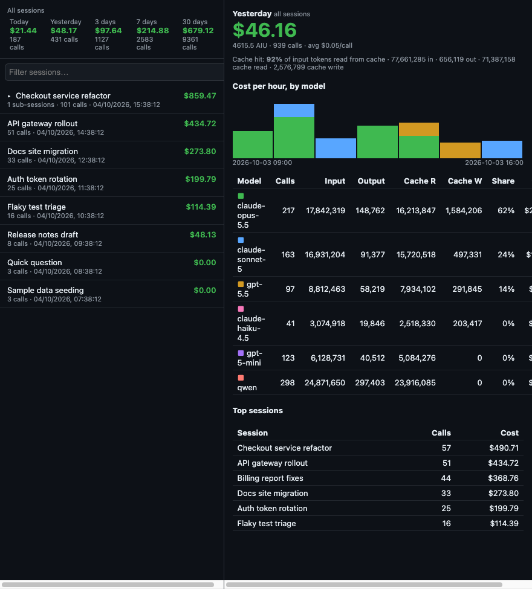

# copilot-session-costs

A GitHub Copilot App canvas extension that lists your Copilot sessions and shows estimated Copilot cost (AIU / USD), rate of change (last call, last 10, last hour), totals (today, yesterday, 3/7/30 days), parent/child grouping and per-model token breakdowns.

## Install

**Ask an agent:**

> Install the extension from https://github.com/kewalaka/copilot-session-costs to user scope.

**Manual:**

- Open the Canvas (right hand) pane → Press '+' → Canvas → Import canvas from gist/URL
- Paste `https://github.com/kewalaka/copilot-session-costs`
- Choose User scope (~/.copilot)

It will then open the "Session costs" canvas.

## Subsequent use

Once installed, it will appear under '+' -> Canvas -> Session costs.

## Updates

The installed version is bundled in `version.txt`, maintained by release-please's `simple` release strategy. The canvas checks the public GitHub repository's latest stable release on opening, then polls a cached result. Successful checks are cached for an hour; failures retry after five minutes. Requests time out after five seconds, use no GitHub token, and send no session data. No releases (HTTP 404) means no update; other failures are shown separately from usage warnings.

A bar appears across the top only when a newer stable version is available, with links to release notes and **Upgrade via agent**. Clicking Upgrade requests that the agent use the supported installer for that exact tag, retaining the current installation's name and user/project/session scope. It does not silently replace files. Plugin-managed installations only offer the release notes.

The runtime SDK supports `session.rpc.extensions.reload()` from an extension process. This restarts extension providers in the current session and rehydrates open canvases; it is not an install operation or a reload of other active sessions. The supported installer performs the reload after upgrading.

## Caveats

- Assumes 1 AIU = $0.01 (`AIU_USD` in `server.mjs`).
- External/BYOK usage is shown separately with its token counts. Provider charges (for example, Azure or APIM) are not known to Copilot and are not included in the displayed estimate; an em dash means no AIU cost was reported, not that the provider was free.
- Reads the app's local SQLite stores read-only and the session `events.jsonl` files; internal schemas may change without notice. If the legacy usage table is absent, only session logs are shown and a warning is displayed. Legacy SQLite records without matching logs have an unspecified billing source.
- Requires a Node runtime with `node:sqlite`.

## Usage reconciliation

The extension combines legacy SQLite usage with newer `session.usage_record` events. JSONL copies with the same accounting source and usage ID count once, including copies in parent and child sessions. When the original session is present, the call belongs to it; otherwise an ancestor recording the call is preferred. Events without a stable usage or API call ID are retained but cannot be deduplicated across sessions; events without an accounting source may also remain duplicated.

Legacy SQLite rows do not contain usage IDs. Overlapping records are matched one-to-one within each recording session using their model, token counts, timestamps within 10 ms, and other fields when available. This avoids a global or per-session cutoff, but older records with indistinguishable details may still be ambiguous. Unreadable or malformed logs are reported in the canvas. Unchanged logs are not reread on refresh.

## Development

Run the built-in regression tests with `node --test`.

## Removal

- Go to Customize → Extensions → session-costs
- Use the link to delete from the file system (it installs under .copilot/extensions)
